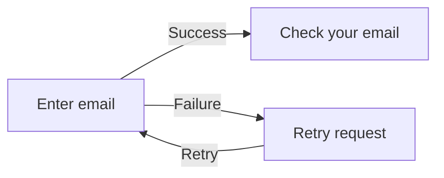

# Reviewed-map workflow example

These contracts describe a **synthetic, unapproved** reset-password feature.
They are valid draft inputs, not a real Penpot inspection, code audit, owner
review or finalized design release. `sample-source.md` is their only observed
source. Proposed application architecture and unknown policy stay labeled.

From the repository root:

```sh
pnpm build
node packages/web/dist/cli.js journey-map render --from examples/design-release-maps/journey.json
node packages/web/dist/cli.js integration-map render --from examples/design-release-maps/integration.json
```

Use the installed CLI entrypoint when working from a packaged installation.
Rendering is offline and establishes neither owner approval nor live fidelity.
Checks/context should retain the open blockers and missing reviews; this fixture
is intentionally not ready for implementation or release finalization.

## Read the map



Each JSON node uses a concise `label` as its title, a one-line `summary`, a
longer `description` for evidence and decisions, and a fixed semantic `icon`.
Native cards show the compact title/summary with origin badges; detailed notes
retain the full explanation below the flow. The short labels above do not
change provenance: entry/confirmation are observations of the synthetic text,
while success, failure and retry behavior remain proposals. Policy and actual
code/browser evidence remain unknown.

This short illustration explains the intended flow; the JSON contract remains
authoritative. Generate full Mermaid/native drawing plans from it rather than
editing this illustration as if it updated the contract. A native drawing is
editable, but managed semantic changes must be imported as proposals, reviewed,
accepted against their base hash and approved again.

| Requirement | Intended result | Hypothetical mismatch | Next action |
| --- | --- | --- | --- |
| `reset-error-retry` | Keep the address after a failed request and allow retry | An implementation clears it and makes the person retype it | Confirm the proposed behavior, then test a real failed request and retry. This row is not observed project evidence. |

## Three review gates

1. **Intent ready:** inspect real source frames; decide request, disclosure,
   expiry, recovery, loading and focus behavior. Do not convert unknown policy
   into an inferred security rule.
2. **Design package reviewed:** replace synthetic sources with actual inspection
   paths/hashes, review the exact journey/integration maps, assemble target
   native frames in `release/<product-version>`, verify fidelity, then obtain
   the actual owner words for the exact release candidate. Source image
   approval does not approve new target frame identities.
3. **Implementation accepted:** implement against that stable context, observe
   actual route/state/fixture behavior, compare browser images, test recovery
   and accessibility, and review the results. Finalized design alone cannot
   satisfy this gate.

No release plan with invented file IDs, frame IDs, transfer receipts or owner
words is included. Create a plan only after inspecting the actual pinned file
and selecting sources. The [release guide](../../docs/design-releases.md)
describes the native copy, immutable evidence and later drift checks.

New baselines default to static lossless WebP. Preserve existing approved PNG
bytes; format migration is explicit and requires normal exact-byte review.
